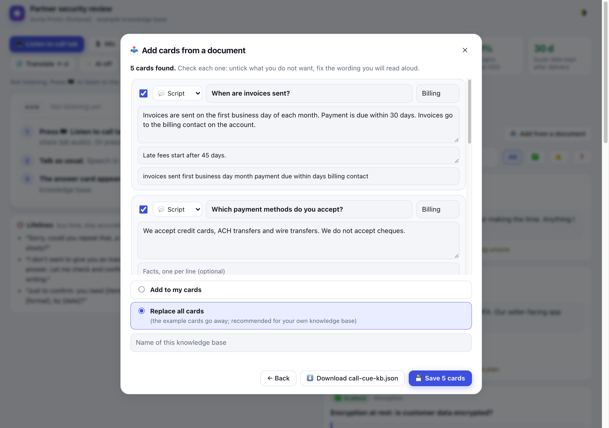

# call-cue

**Live answer cards for calls.** call-cue listens to a call (a browser tab, your mic, or
Windows Live Captions), and when the other side asks something your knowledge base covers,
the approved answer appears on screen by itself. No typing during the call.

**▶️ [Try it in your browser](https://lyhuuloi.github.io/call-cue/)**: no install, a sample call
plays by itself (Chrome recommended).


- 🔒 **Private by default.** Speech recognition and translation run on your device in
  Chrome. Without AI keys, nothing leaves your machine.
- 📥 **Load your knowledge base from documents, in the page:** drop a PDF, Word file,
  text, Markdown, HTML or CSV file (or paste text) and it becomes answer cards.
- 🗂️ **It is stored as one JSON file:** answer cards, numbers, lifelines and
  "don't say" lines.
- ✨ **Optional AI, opt-in on every call.** Works with **Claude, ChatGPT, DeepSeek,
  OpenCode** or any OpenAI-compatible endpoint (Ollama, OpenRouter…). It picks the card
  when the keywords miss, drafts a reply when no card fits, and summarises the call.
- 🌐 **On-device translation** of what you hear (Chrome Translator API).
- 📝 **Transcript** that stays in your browser, with copy and save to `.txt`.

## What you need

| | Needed | Notes |
|---|---|---|
| 💻 | **Node.js 20 or newer** | Check with `node -v`. Get it from [nodejs.org](https://nodejs.org). |
| 🌐 | **Google Chrome on a computer**, a recent version (139 or newer) | Speech recognition and translation run inside Chrome. Other browsers and phones show the cards but may not listen. |
| 🎧 | **A way for the page to hear the call** | The call in a Chrome tab (Zoom, Meet, Teams web), **or** a microphone with the call on speakers, **or** Windows 11 Live Captions for desktop call apps. |
| 🗣️ | **The other side speaks English** | US, UK, India and Australia accents are in the list. |
| 🗂️ | **Your answers in one JSON file** | `init` creates a starter file for you to edit. |
| ✨ | *Optional:* one AI key | Claude, ChatGPT, DeepSeek, OpenCode or any OpenAI-compatible endpoint. Without a key the keyword matcher still works, fully offline. |

No account, no build step, no database.

## Quick start

**1️⃣ See it work** (no keys, no microphone; a sample call plays by itself):

```bash
npx github:lyhuuloi/call-cue --demo
```

**2️⃣ Create your files** in the folder you will start it from:

```bash
npx github:lyhuuloi/call-cue init
```

This writes `call-cue-kb.json` (your answer cards, a copy of the example) and `.env`
(where an AI key goes, optional).

**3️⃣ Run it on a real call:**

```bash
npx github:lyhuuloi/call-cue
```

Chrome opens at `http://127.0.0.1:8765/`. Press **🖥️ Listen to call tab**, pick the tab
with your call and tick **Also share tab audio**. Or press **🎙️ Mic**.

**4️⃣ Put in your own answers:** press **📥 Add from a document** in the page (next
section), or edit `call-cue-kb.json` by hand.

✅ **It works when** the sentence you hear appears next to **NOW** and a card shows up
under it. The first time, Chrome downloads its on-device speech model; press the button
again if it asks.

💡 Tired of typing `npx github:...`? Install it once, then the command is just `call-cue`:

```bash
npm install -g github:lyhuuloi/call-cue
```

| Option | What it does |
|---|---|
| `--kb my-kb.json` | Use another knowledge base file |
| `--port 9000` | Use another port |
| `--no-open` | Do not open the browser |
| `--demo` | Sample call with a pretend AI |

The 🌗 button switches between light and dark.

<details><summary>Light theme</summary>


</details>

<details><summary>Prefer a clone?</summary>

```bash
git clone https://github.com/lyhuuloi/call-cue && cd call-cue
npm install         # only needed for Claude
npm run demo        # sample call with a pretend AI
npm start           # real use
```
</details>

### Windows Live Captions (optional)

On Windows 11 you can feed Live Captions instead, which works with desktop call apps too.
From a clone:

```powershell
# 1. Turn on Live Captions: Win + Ctrl + L
npm start
powershell -ExecutionPolicy Bypass -File captions\live-captions.ps1
```

The relay reads the Live Captions window on your machine and serves it only to the
call-cue page at `127.0.0.1`. It also writes `call-transcript-*.txt` next to the script
(`-NoTranscript` turns that off).

## AI (optional): bring the one you already use


With one key, the AI does three things: **picks the card** when the keywords miss,
**drafts a reply** (marked *AI draft, not approved*) when no card fits, and writes a
**summary with follow-ups** after the call.

Put **one** line in the `.env` file that `init` created, then start call-cue again:

| You use | Line in `.env` | Default model |
|---|---|---|
| **Claude** (Anthropic) | `ANTHROPIC_API_KEY=...` | `claude-opus-5-5` |
| **ChatGPT** (OpenAI) | `OPENAI_API_KEY=...` | `gpt-6-luna` |
| **DeepSeek** | `DEEPSEEK_API_KEY=...` | `deepseek-flash` |
| **OpenCode** | `OPENCODE_API_KEY=...` | `deepseek-v4.1-flash` |
| **Anything OpenAI-compatible** (Ollama, OpenRouter, LM Studio, a company gateway) | `CALL_CUE_AI_BASE_URL=http://127.0.0.1:11434/v1` and `CALL_CUE_AI_MODEL=...` (`CALL_CUE_AI_KEY=...` if it needs one) | you choose |

✅ **It works when** the start-up line names your provider and the page button reads
**✨ AI off** instead of **✨ AI: add a key**.

- **Several keys set?** The first one in the table wins. To choose, add
  `CALL_CUE_AI=claude` (or `openai`, `deepseek`, `opencode`, `custom`).
- **Another model?** Add `CALL_CUE_AI_MODEL=...`. If the service answers "model not
  found", this is the line to change.
- **Local model, nothing leaves your machine:** point the last row at Ollama or LM Studio.
- *Optional:* `TYPESAFE_API_KEY` lets [Jev](https://docs.typesafe.ai), a fast model made
  for this kind of choice, pick the card; your chat model still drafts and summarises.
  Tune with `CALL_CUE_MATCH_THRESHOLD` (default `0.5`).

Keys stay in the local server; the page never sees them. Even with a key set, AI stays
**off until you press ✨ AI** in the page. While it is on:

- only **text** of finished sentences is sent (never audio), and a **● sending** marker
  shows each request;
- the summary asks for confirmation before sending the transcript.

⚠️ `.env` holds a secret. Keep it out of git and shared folders.

## Add your knowledge base from documents



1. Press **📥 Add from a document** above the cards.
2. Drop your files or paste text. Supported: **PDF, Word (.docx), text, Markdown, HTML,
   CSV, JSON** (a call-cue knowledge base). Old `.doc`, Pages and scanned PDFs without
   text are not read: save them as `.docx` or a text PDF first.
3. Choose how the cards are made:

   | | What it does | What leaves your machine |
   |---|---|---|
   | ✂️ **Split by headings and questions** | Each heading or question becomes a card, the text under it becomes the answer. Best for FAQ-style documents. | Nothing |
   | ✨ **Let the AI write the cards** (needs an AI key) | The AI reads the text and writes short answers, facts and keywords. Best for policies and long prose. | The document text goes to the AI you configured |

4. **Check every card** (untick, fix the wording you will read aloud), pick **Add to my
   cards** or **Replace all cards**, then **💾 Save**.

✅ Done when the page shows your cards and the line above them reads
`N cards · call-cue-kb.json`. The file is written in the folder you started call-cue
from; the previous version is kept next to it as `call-cue-kb.json.bak`. The bundled
example is never changed. ⬇️ **Download** gives you the file without saving.

⚠️ The AI can misread a document. Read each card before you rely on it in a call.

Files are opened in your browser and are not uploaded. PDF reading uses the bundled
[pdf.js](https://mozilla.github.io/pdf.js/) (Apache-2.0, in `public/vendor/`).

## Knowledge base format

See [`kb/example.json`](kb/example.json) (a fictional company). The essentials:

```jsonc
{
  "title": "Partner security review",
  "captionLang": "en-US",          // speech recognition language
  "translateTo": "vi",             // target of 🌐 Translate
  "fallback": "Let me check that and confirm in writing.",
  "cards": [
    {
      "id": "mfa",                  // letters, digits, - or _; "none" is reserved
      "status": "gap",              // ok | gap | ask | info
      "topic": "Access",
      "title": "Do you enforce MFA?",
      "say": ["Staff sign in through single sign-on with MFA..."],   // read aloud
      "facts": ["✅ SSO + MFA for all staff."],
      "note": "A private note for you",
      "keywords": "mfa 2fa two factor",                             // search + AI hints
      "triggers": [["mfa", 3], ["two factor", 3], ["authentic*", 1]] // phrase, weight; * = prefix
    }
  ],
  "stats": [{ "value": "12 / 12", "label": "buckets encrypted", "tone": "ok" }],
  "lifelines": ["Sorry, could you repeat that?"],
  "dontSay": ["No dates you have not checked."],
  "docs": "Background text the AI may draft from",   // or "docsFile": "notes.md"
  "demo": ["Do you enforce MFA?"]                    // lines for ?demo
}
```

Up to 254 cards. The keyword matcher works offline and instantly; when AI is on, its pick
replaces the keyword pick unless you have pinned a card.

## Security notes

- The server listens on `127.0.0.1` only. It rejects other `Host` names (DNS rebinding)
  and cross-site `POST`s, so another web page cannot spend your API keys.
- Transcripts live in your browser's local storage until you press 🧹 New session.
- Cloud speech recognition is off unless you press ☁️ (it sends audio to the browser
  vendor).
- Tell the other side if you record or transcribe a call where the law requires it.

## Development

```bash
npm test            # node --test, no network
node server.mjs --demo
npm run build:web    # the static web demo, into dist/
```

Changes per version: [CHANGELOG.md](CHANGELOG.md). Every version bump adds an entry
there; `npm test` fails when the version in `package.json` has none.

## Tiếng Việt (tóm tắt)

**call-cue** nghe cuộc gọi (tab trình duyệt, mic, hoặc Windows Live Captions) và **tự hiện
thẻ trả lời** khi đối phương hỏi đúng chủ đề trong knowledge base của bạn.

**Cần có:** Node.js 20 trở lên · Google Chrome bản mới trên máy tính (139 trở lên) ·
cuộc gọi mở trong tab Chrome, hoặc mic + loa ngoài · đối phương nói tiếng Anh · một file
JSON chứa câu trả lời của bạn. Key AI là **tuỳ chọn**.

```bash
npx github:lyhuuloi/call-cue --demo   # 1. xem thử, không cần key
npx github:lyhuuloi/call-cue init     # 2. tạo call-cue-kb.json và .env
npx github:lyhuuloi/call-cue          # 3. chạy thật
```

- Nhận dạng giọng nói và dịch chạy **trên máy**. Không có key AI thì không gửi gì ra ngoài.
- **AI nào cũng được:** thêm một dòng vào `.env`: `ANTHROPIC_API_KEY` (Claude),
  `OPENAI_API_KEY` (ChatGPT), `DEEPSEEK_API_KEY` (DeepSeek), `OPENCODE_API_KEY` (OpenCode),
  hoặc `CALL_CUE_AI_BASE_URL` + `CALL_CUE_AI_MODEL` cho Ollama, OpenRouter…
- **Nạp knowledge base từ tài liệu ngay trên trang:** bấm **📥 Add from a document**, thả
  file PDF, Word (.docx), text, Markdown, HTML, CSV (hoặc dán chữ), kiểm tra các thẻ rồi
  bấm **💾 Save**. File được đọc trong trình duyệt; thẻ lưu vào `call-cue-kb.json`.
- AI chỉ chạy khi bạn bấm **✨ AI** trên trang, và chỉ gửi chữ, không gửi âm thanh.
- Xem thử ngay trên trình duyệt, không cần cài: https://lyhuuloi.github.io/call-cue/

## License

[MIT](LICENSE)
