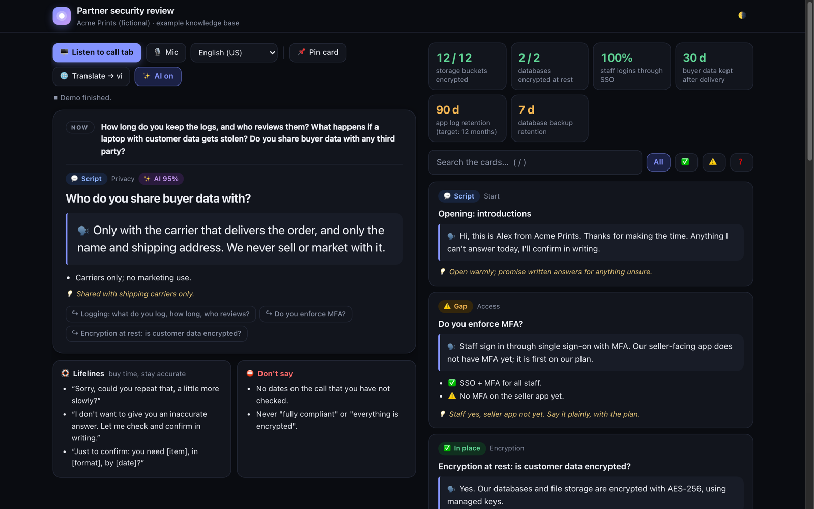
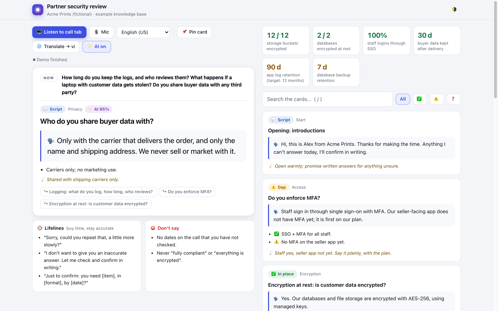
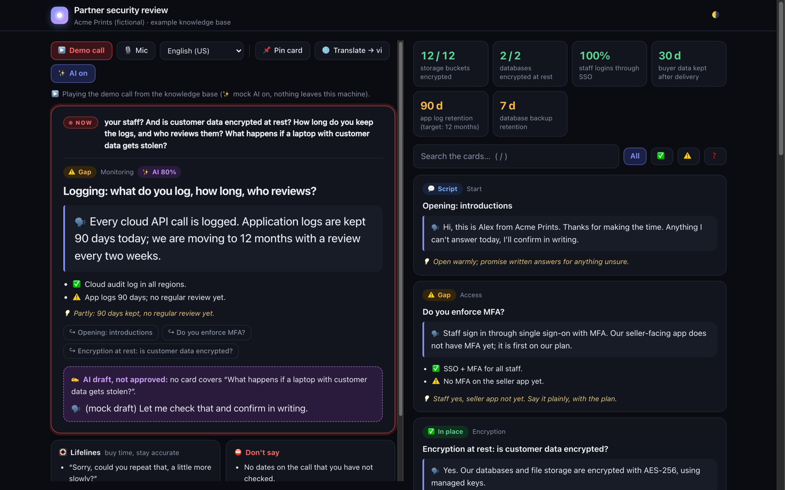

# call-cue

**Live answer cards for calls.** call-cue listens to a call (a browser tab, your mic, or
Windows Live Captions), and when the other side asks something your knowledge base covers,
the approved answer appears on screen by itself. No typing during the call.

**▶️ [Try it in your browser](https://lyhuuloi.github.io/call-cue/)**: no install, a sample call
plays by itself (Chrome recommended).



- 🔒 **Private by default.** Speech recognition and translation run on your device in
  Chrome. Without AI keys, nothing leaves your machine.
- 🗂️ **Your knowledge base is one JSON file:** answer cards, numbers, lifelines and
  "don't say" lines.
- ✨ **Optional AI, opt-in on every call.** [Jev](https://docs.typesafe.ai) picks the
  right card when the keywords miss. [Claude](https://docs.anthropic.com) drafts a reply
  when no card fits, and writes a summary with follow-ups after the call.
- 🌐 **On-device translation** of what you hear (Chrome Translator API).
- 📝 **Transcript** that stays in your browser, with copy and save to `.txt`.

## Quick start

You need **Node.js 20+** and **Google Chrome**. One command, nothing to configure:

```bash
npx github:lyhuuloi/call-cue --demo
```

It opens Chrome and plays a sample call with a mock AI, so you can see it work without
keys or a microphone. Nothing leaves your machine.

**On a real call:**

```bash
npx github:lyhuuloi/call-cue                      # http://127.0.0.1:8765/
npx github:lyhuuloi/call-cue --kb my-kb.json      # your own knowledge base
```

Then press **🖥️ Listen to call tab**, pick the tab with your Zoom / Meet / Teams call and
tick **Also share tab audio**. Or press **🎙️ Mic**. The first time, Chrome downloads its
on-device speech model (press the button again if it asks).

It follows your system's light or dark theme.

<details><summary>Light theme</summary>


</details>

<details><summary>Prefer a clone?</summary>

```bash
git clone https://github.com/lyhuuloi/call-cue && cd call-cue
npm run demo        # sample call with mock AI
npm start           # real use, opens the page
```
</details>

### Windows Live Captions (optional)

On Windows 11 you can feed Live Captions instead, which works with desktop call apps too.
From a clone:

```powershell
# 1. Turn on Live Captions: Win + Ctrl + L
npm start
powershell -ExecutionPolicy Bypass -File captions\live-captions.ps1
```

The relay reads the Live Captions window on your machine and serves it only to the
call-cue page at `127.0.0.1`. It also writes `call-transcript-*.txt` next to the script
(`-NoTranscript` turns that off).

## AI helpers (optional)



| Helper | What it does | Enable with |
|---|---|---|
| **Card matching** (Jev) | Picks the card for each finished sentence when keywords miss; says "none" when no card fits | `TYPESAFE_API_KEY` |
| **Drafts** (Claude) | When no card fits a question, drafts 1 to 3 sentences from your knowledge base, shown as *AI draft, not approved* | `ANTHROPIC_API_KEY` |
| **Summary** (Claude) | After the call: what was asked, what was answered, follow-ups | `ANTHROPIC_API_KEY` |

```bash
export TYPESAFE_API_KEY=...                  # https://typesafe.ai
export ANTHROPIC_API_KEY=...                 # https://console.anthropic.com
npx github:lyhuuloi/call-cue                  # (from a clone: npm install && npm start)
```

Keys stay in the local server; the page never sees them. Even with keys set, AI stays
**off until you press ✨ AI** in the page. While it is on:

- only **text** of finished sentences is sent (never audio), and a **● sending** marker
  shows each request;
- the summary asks for confirmation before sending the transcript.

Tune with `CALL_CUE_MATCH_THRESHOLD` (default `0.5`), `CALL_CUE_JEV_MODEL`
(default `jev-latest`) and `CALL_CUE_CLAUDE_MODEL` (default `claude-opus-5-5`).

## Knowledge base format

See [`kb/example.json`](kb/example.json) (a fictional company). The essentials:

```jsonc
{
  "title": "Partner security review",
  "captionLang": "en-US",          // speech recognition language
  "translateTo": "vi",             // target of 🌐 Translate
  "fallback": "Let me check that and confirm in writing.",
  "cards": [
    {
      "id": "mfa",                  // letters, digits, - or _; "none" is reserved
      "status": "gap",              // ok | gap | ask | info
      "topic": "Access",
      "title": "Do you enforce MFA?",
      "say": ["Staff sign in through single sign-on with MFA..."],   // read aloud
      "facts": ["✅ SSO + MFA for all staff."],
      "note": "A private note for you",
      "keywords": "mfa 2fa two factor",                             // search + AI hints
      "triggers": [["mfa", 3], ["two factor", 3], ["authentic*", 1]] // phrase, weight; * = prefix
    }
  ],
  "stats": [{ "value": "12 / 12", "label": "buckets encrypted", "tone": "ok" }],
  "lifelines": ["Sorry, could you repeat that?"],
  "dontSay": ["No dates you have not checked."],
  "docs": "Background text the AI may draft from",   // or "docsFile": "notes.md"
  "demo": ["Do you enforce MFA?"]                    // lines for ?demo
}
```

Up to 254 cards. The keyword matcher works offline and instantly; when AI is on, its pick
replaces the keyword pick unless you have pinned a card.

## Security notes

- The server listens on `127.0.0.1` only. It rejects other `Host` names (DNS rebinding)
  and cross-site `POST`s, so another web page cannot spend your API keys.
- Transcripts live in your browser's local storage until you press 🧹 New session.
- Cloud speech recognition is off unless you press ☁️ (it sends audio to the browser
  vendor).
- Tell the other side if you record or transcribe a call where the law requires it.

## Development

```bash
npm test            # node --test, no network
node server.mjs --demo
```

## Tiếng Việt (tóm tắt)

**call-cue** nghe cuộc gọi (tab trình duyệt, mic, hoặc Windows Live Captions) và **tự hiện
thẻ trả lời** khi đối phương hỏi đúng chủ đề trong knowledge base của bạn.

- Nhận dạng giọng nói và dịch chạy **trên máy**. Không có key AI thì không gửi gì ra ngoài.
- Knowledge base là **một file JSON** (xem `kb/example.json`).
- AI là **tuỳ chọn** và phải bấm **✨ AI** mới bật: Jev chọn thẻ, Claude viết nháp khi
  không có thẻ phù hợp và tóm tắt sau cuộc gọi.
- Xem thử ngay trên trình duyệt, không cần cài: https://lyhuuloi.github.io/call-cue/
- Chạy trên máy, một lệnh: `npx github:lyhuuloi/call-cue --demo`.

## License

[MIT](LICENSE)
